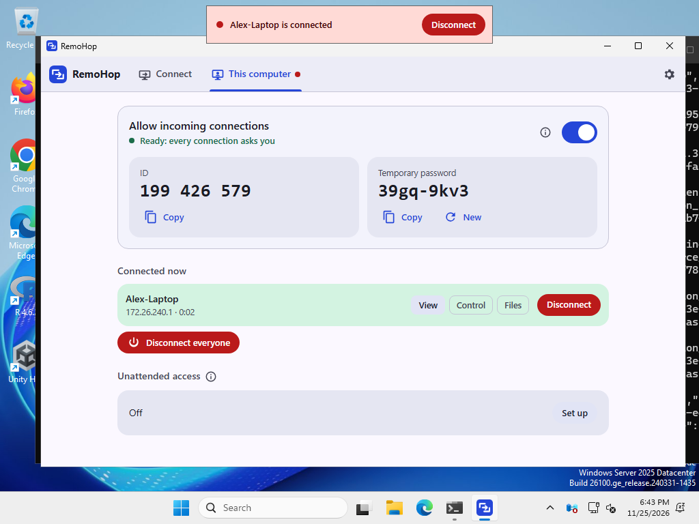
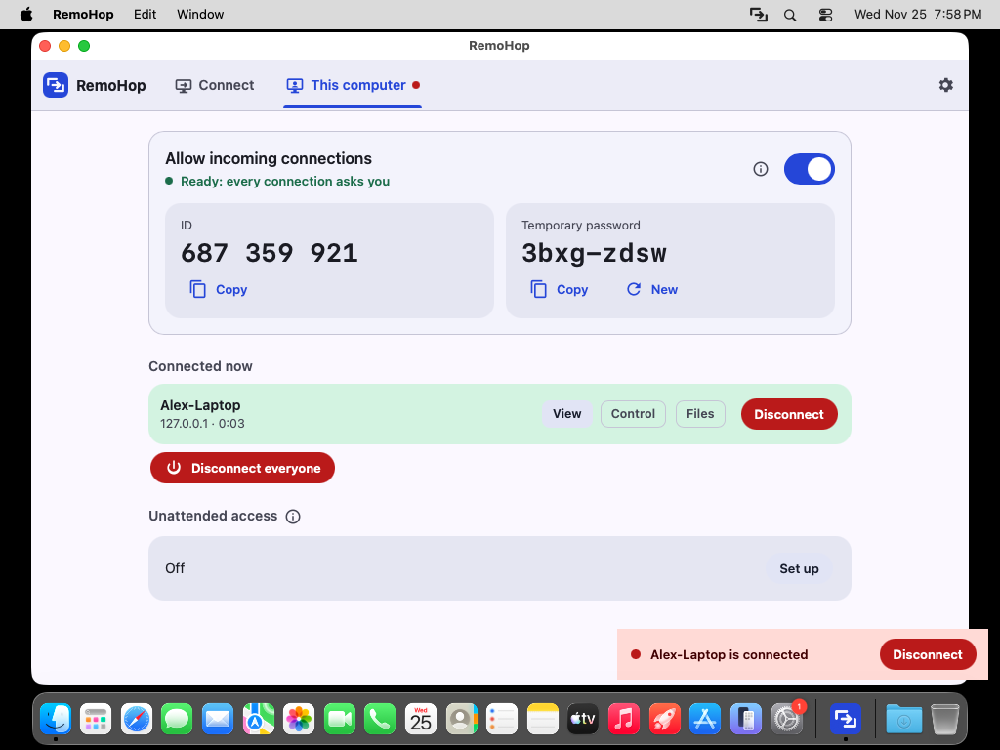

# The desktop app: design notes

One desktop client that connects to other computers and can be connected to,
on Windows, macOS and Linux: `remohop app`, and what a double-click on
RemoHop.exe, RemoHop.app or `remohop-quick` opens. The user guide is
[en/desktop-app.md](en/desktop-app.md) ([中文](zh/desktop-app.md)). This page
records the technical spike that came first, the decisions it led to, and
how the pieces fit, for people reading the code.

## Spike: native web views without cgo

The app's UI is web pages (the console of `remohop web` already is), so the
question was how to show them in a window of the app's own rather than in a
browser, without giving up pure-Go, `CGO_ENABLED=0` builds. Measured with the
hidden `remohop-quick webview-selftest` command (`internal/webview/selftest.go`)
on GitHub's hosted runners (workflow `remohop-desktop-app.yml` in the CI
repository) and on an Ubuntu 24.04 container:

| | Windows | macOS | Linux |
|---|---|---|---|
| Engine | WebView2 157 (Edge's runtime, part of Windows 10/11) | WKWebView, WebKit 21624 (macOS 26.7) | WebKitGTK 2.52.6 (Ubuntu 24.04 updates) |
| Binding | COM vtables through `golang.org/x/sys/windows`: [go-webview2](https://github.com/jchv/go-webview2)'s `edge` package (MIT; embeds Microsoft's BSD-licensed WebView2Loader and loads it from memory) | Objective-C runtime through [purego](https://github.com/ebitengine/purego)'s `objc` (already a dependency) | `dlopen` of libgtk-3, libwebkit2gtk-4.1 (or 4.0) and libayatana-appindicator3 through purego |
| cgo | no | no | no, but the binary becomes **dynamically linked** against the C library (purego's fake cgo) |
| `remohop-quick` size (stripped, amd64 / arm64 mac) | +349 KB (18.8 → 19.1 MB) | +153 KB (17.7 → 17.8 MB) | +135 KB (19.06 → 19.20 MB) |
| WebCodecs `VideoDecoder` | yes | yes | yes (on by default in 2.52; the app switches it on where an older version has the setting off) |
| H.264 1080p (`avc1.42002a`) | software (runner VM has no GPU) | hardware and software (VideoToolbox) | through GStreamer: needs `gstreamer1.0-libav` (or another H.264 decoder); without one `isConfigSupported` says false, honestly |
| AV1 | software | hardware and software | needs GStreamer's dav1d plugin (`gstreamer1.0-plugins-bad`) |
| Decode latency, 1080p clip at 30 fps (p50 / p95) | 1.4 / 1.6 ms (`prefer-software`; the VM has no hardware decoder) | 6 / 49 ms (`prefer-hardware`, what the viewer asks for) | 2 / 2 ms |
| Same page in the system's browser | Edge: 1.4 / 1.6 ms (same engine) | Safari: did not report on the runner (first-run prompt) | Chrome 157: 1.5 / 3.9 ms |

Each pass feeds the clip at 30 frames a second, as a host sends it, and
measures from `decode()` to the decoded frame. On the Windows runner (no GPU)
`prefer-hardware` is refused and the first `no-preference` pass had a tail
of about 0.8 s in WebView2 and in Edge alike (start-up), so the web view adds
nothing over the browser. On the macOS runner (a VM) the hardware decoder gave 6 / 49 ms while the
software decoder and `no-preference` had tails of about 1.4 s with no frame
held until `flush()`: the VM's CPU, not buffering. The viewer already asks for
`prefer-hardware` first (`internal/web/assets/desktop.js`), which is the fast
path there; real Macs should still be checked before a release.





Without any native web view (no WebView2 runtime, no WebKitGTK, a headless
system, the static `remohop` binary) the app runs in a browser window
instead: an app window of Microsoft Edge on Windows, the default browser
elsewhere, through the same private redirect file quick support uses
(`internal/handoff`).

### Other platform pieces, all without cgo

- **Tray icon.** Windows: `Shell_NotifyIcon` and a popup menu (plain system
  calls). macOS: `NSStatusItem` with a template image. Linux: AppIndicator
  (`libayatana-appindicator3`, else `libappindicator3`) over the GTK menu;
  GNOME needs its AppIndicator extension (Ubuntu has it). Without a tray the
  window cannot hide, so closing it quits.
- **"Allow this connection?"** The main window comes to the front with the
  dialog (Windows flashes the task bar button when it may not take the
  foreground). No separate notification system: the decision must be made in
  the app, with its warning.
- **Being controlled.** A small undecorated window in the bottom-right corner
  of the work area (where notifications appear, clear of the menu bar and of
  the app's own window and tab bar) that stays above all others while anyone
  is connected (Win32 `WS_EX_TOPMOST|WS_EX_TOOLWINDOW|
  WS_EX_NOACTIVATE`, `NSFloatingWindowLevel` on all Spaces, GTK keep-above;
  Wayland compositors place it where they like).
- **Start at login.** Windows: `HKCU\…\Run`; macOS: a LaunchAgent
  (`com.remohop.app`, distinct from the host service's `com.remohop.host`);
  Linux: `~/.config/autostart/remohop.desktop`. All are files or registry
  values written in Go, started with `app --hidden` (tray only).
- **Single instance.** A lock file in the config directory; a second start
  reads the running app's page address (`desktop.url`, 0600) and asks it to
  show its window.
- **Elevation.** Only Windows needs it, and only on demand: the app runs
  unelevated, and each unattended-access step (install, remove, list the
  service's sessions, disconnect one, change the password) starts the app
  itself with the `runas` verb (`ShellExecuteEx`) and a hidden
  `desktop-unattended` command, which talks to the service's control channel
  (`hostd.ControlSessions`, `ControlDisconnect`) or writes its settings in
  `%ProgramData%\RemoHop`. Arguments and results go through files in the
  user's private run directory (the elevated step refuses any other path);
  the password never appears on a command line.

## Decisions

1. **Extend `cmd/remohop-quick`, no new command.** It already is the
   double-click product on every platform: the GUI-subsystem RemoHop.exe with
   icon and manifest, RemoHop.app with its bundle ID, signing and
   notarisation, and the byte-for-byte rebuild check of the release.
2. **Two downloads, one program, told apart by name** (owner's choice: the
   person being helped must never need a flag). `cmd/remohop-quick/launch.go`:
   a file name with "quick" in it starts quick support, any other the app.
   - Windows: `RemoHop.exe` and `RemoHop-QuickSupport.exe`, the same signed
     file renamed (Authenticode does not cover the name), in
     `RemoHop-windows-*.zip` and `RemoHop-QuickSupport-windows-*.zip`.
   - macOS: `RemoHop.app` (`com.remohop.quick`, kept so that users keep their
     Screen Recording and Accessibility grants) and `RemoHop Quick
     Support.app` (`com.remohop.quicksupport`, executable
     `RemoHop-QuickSupport`), the same universal program in two bundles,
     both signed, notarized and stapled by the CI repository's workflow and
     both compared with a rebuild by `scripts/verify-macos-release.sh`;
     `RemoHop-macos.dmg` (the app) and `RemoHop-QuickSupport-macos.zip`
     (unzip and open).
   - Linux: `remohop-app_linux_*.tar.gz` and `remohop-quick_linux_*.tar.gz`.
   `RemoHop.exe --quick` still works from any name.
3. **No cgo anywhere.** All three platforms work through system calls and
   purego, so every binary still cross-compiles from Linux and the macOS
   release check (rebuild and compare with the signed files) keeps working.
   The one cost is on Linux, where `remohop-app`/`remohop-quick` are now
   dynamically linked against glibc (accepted by the owner); `remohop` itself stays static (a test in `cmd/remohop`
   keeps purego and `internal/webview` out of it), and `remohop app` from that
   binary runs the same app in a browser.
4. **The web view package is linked only into the app binary.**
   `internal/nativeui` is the interface (types, a registry); `internal/webview`
   registers the implementation from `init` and is imported by
   `cmd/remohop-quick` alone. `internal/desktop` (the app) is in both binaries.
5. **Linux remote desktop stays in the app window** when WebKitGTK can decode
   (it can, with GStreamer's libav plugin, as fast as Chrome); where it cannot,
   the viewer reports the codec it cannot decode, and the packaging lists
   `gstreamer1.0-libav` as a recommendation. No native decoder.
6. **One window, a sidebar** (owner's choice, first over two side-by-side
   panes, later over top tabs): Home (this computer's ID and password, quick
   connect, counts and the last hour's activity), Connect (the address
   book) and Sessions (the approval queue, who is connected, the computers
   open here, remembered devices) as fixed places; each connected host as a
   closable row under them (a vertical list holds many hosts better than a
   row of tabs); Settings and this computer's status at the foot. It folds
   into an icon rail by choice and in windows narrower than 900 px, so the
   same layout works from about 480 px wide up. A host can be popped out
   into a window of its own. The visual design (tokens, components,
   screens) is [design/desktop-ui.md](design/desktop-ui.md).

## How it fits together

```
 RemoHop.exe / RemoHop.app / remohop-quick  (cmd/remohop-quick)
 ├── internal/webview      native windows + tray (registers internal/nativeui)
 └── internal/desktop      remohop app
     ├── App               settings, this computer's host (internal/hostd, in process),
     │                     requests and per-session access, address book, unattended access
     ├── Server            the page on 127.0.0.1 (internal/localui: token, CSRF, CSP)
     │   └── assets/       index.html, app.js, style.css, overlay.html
     └── gateway           internal/web in process, persistent mode, framed by the page:
                           each host tab is an iframe of its console (?embed=1)
```

- **Host side.** The app's host asks about every login (`Overrides.AskAll`),
  accepts only its temporary password and mints no pairings. The answer is
  per session: `hostd.Host.DecideWith` lets a login use only the screen and
  system information, plus mouse and keyboard, plus files and clipboard, as
  ticked; the user can change that for a live session
  (`SetSessionFeatures`), and a limited session can ask for more
  (`hostd.ServiceAccess`, a new approval with a cool-down after a refusal).
  Narrowing ends what is open with the withdrawn feature, through the
  existing feature watches. A remembered device (`desktop.json`, by key
  fingerprint) is let in with the access chosen when it was remembered.
- **Connect side.** The gateway runs in persistent mode (sessions reconnect
  after the network drops, until the user closes them). The page frames it:
  the gateway allows exactly the page's origin as a frame ancestor
  (`web.Config.FrameAncestor`), the page's CSP allows exactly the gateway's
  origin as a frame source. All host tabs share one gateway browser session
  (same top-level page), so no tab takes another's connections; popping out
  hands the session id to the new window in the URL fragment. Closing a tab
  ends that host's session (`web.Server.DisconnectTarget`).
- **Rendezvous server.** There is no built-in default. The first-run wizard
  offers the official `signal.remohop.com`, one's own, or none (connect by
  `host:port`, and this computer is reachable by address on its network). The
  choice is the `signal` setting the command line uses too, and Settings can
  change it.

## Tests

- `internal/hostd`: per-session limits and access requests over real
  sessions (`TestSessionLimit`, `TestSessionAccessAllowed`).
- `internal/localui`: token, Host, Origin, CSRF, CSP, events, presence.
- `internal/desktop`: `TestPageInBrowser` (`REMOHOP_BROWSER_TEST=1`) drives
  the real page in headless Chrome against a real App, rendezvous server and
  helper: wizard, incoming on, the approval dialog (new device, scam warning,
  view only by default, deny, allow with control), the approval queue and the
  counts on Home and Sessions, access changes on a live
  session enforced by the host, the address book with presence, a host in a
  tab whose embedded console logs in, closing it, Settings, dark theme,
  Chinese, a 480×720 window and a hostile device name.
- CI repository, `remohop-desktop-app.yml`: on Windows, macOS and Linux
  runners, the web view self-test and `app --smoke`, which walks the real app
  window through its screens (with its own rendezvous server and a simulated
  helper) while the job takes a screenshot of each.
