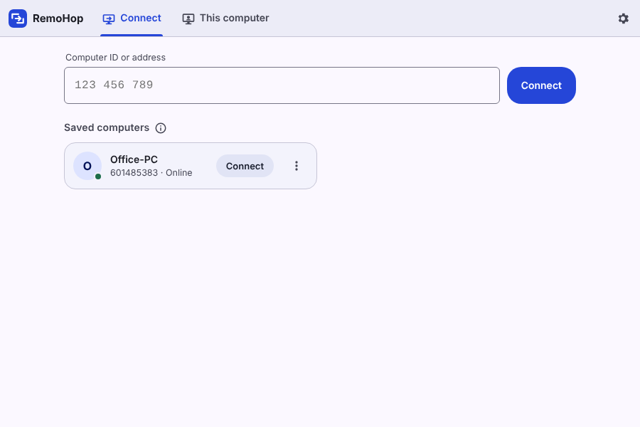
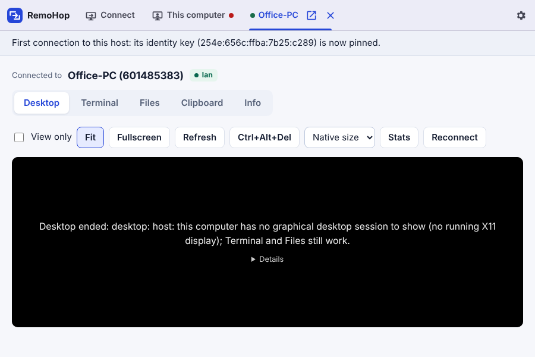

# Desktop app

[中文](../zh/desktop-app.md)

One window to connect to your other computers and to let someone connect to this one, on Windows, macOS and Linux. It is what RemoHop.exe, RemoHop.app and `remohop-quick` open on a double-click (`remohop app` from a terminal).

| This computer | Someone asks to connect |
|---|---|
|  |  |

| Connect | A computer in a tab |
|---|---|
|  |  |

## First start

The app asks for the language (or follows the system) and the **rendezvous server**, the service that introduces computers to each other by ID: the official one (`signal.remohop.com`), your own ([Self-hosting](self-hosting.md)), or none for now. Without a server you connect by address (`host:port`), and this computer is reachable by address on its own network. Settings changes the choice later; it is the same setting as `remohop config set signal`.

A box on that page lets others connect at once. Otherwise incoming connections stay off until you switch them on.

## Connect

Type a 9-digit ID, a name you gave a computer, or `host:port`, or pick one of **Saved computers** (the ones you connected to or paired with, and your account's devices), each with whether it is online. Its menu (⋮) renames it, forgets it, saves its Wake-on-LAN MAC address and wakes it.

Each computer opens in a **tab of its own** next to Connect and This computer, with the familiar Desktop, Terminal, Files, Clipboard and Info tabs ([remote desktop](remote-desktop.md), [browser client](web-gateway.md)). It asks for the password if there is no pairing (ticking "Pair" saves one). ⧉ moves the computer into a window of its own; × disconnects and closes the tab. A connection that drops (sleep, a new network) comes back by itself.

## This computer

- **Allow incoming connections.** Off at first. On, the tab shows this computer's **ID** and a **temporary password** (new on every start; "New" replaces it at once) with Copy buttons.
- **Every connection asks.** A dialog comes to the front over any tab: who asks (the name it gave itself, its key, its address), whether it is a **new device**, and for new devices a warning: *someone who calls saying they are from support, your bank or the police and asks you to install remote software is a scammer.* An allowed device **only sees the screen** unless you tick *Control the mouse and keyboard* or *Transfer files and use the clipboard*. A request nobody answers is refused after a minute. *Remember this device* lets it in next time with the same access, without asking, while incoming connections are on; remembered devices are listed with a Forget button.
- **Connected now** lists each device with switches for Control and Files, which apply at once (a withdrawn permission ends what was open with it), and Disconnect. A device that only watches can ask for more from its side; that is a new question here. The tab shows a red dot, and a small **banner stays on top of all windows** while anyone is connected, with a Disconnect button.
- **Unattended access** makes this computer reachable without anyone at it, from start-up, with a strong password you choose (at least 12 characters, three kinds). It installs RemoHop as a service ([`remohop service install`](quick-start.md)): on Windows the RemoHop service, which can also show the sign-in screen and UAC prompts (Windows asks for an administrator once); on macOS and Linux a service of your user account. Turn it off in the same place.

## Settings

The rendezvous server, the language (Chinese, English or the system's), light or dark (or the system's), and **Start RemoHop when I sign in** (it starts in the tray, without its window).

## Window, tray and background

Closing the window keeps RemoHop running in the tray (the menu bar on macOS), so incoming connections stay possible; Quit in the tray menu ends it and every connection. Starting RemoHop again brings the window back. Where the system has no tray (a Linux desktop without AppIndicator support), closing the window quits.

The window uses the system's web engine: WebView2 on Windows (part of Windows 10 and 11), WKWebView on macOS, WebKitGTK on Linux (the remote desktop there needs GStreamer's H.264 decoder, `gstreamer1.0-libav` on Debian and Ubuntu). Without one the app opens in a browser window instead, as does `remohop app` from the command-line binary.

## Quick support

To help someone just once without anything staying behind, they can run quick support instead: `RemoHop.exe --quick` (or `remohop quick`), which shares the screen at once and quits when its window closes. See [Quick support](quick-support.md).

## Security

The window is a page served by the app on `127.0.0.1` with a random token in its address, the same protections as [quick support](quick-support.md), and nothing in it is reachable from another machine. The computers you connect to run in frames that only the app's own page may show. The design notes are in [desktop-app.md](../desktop-app.md).
