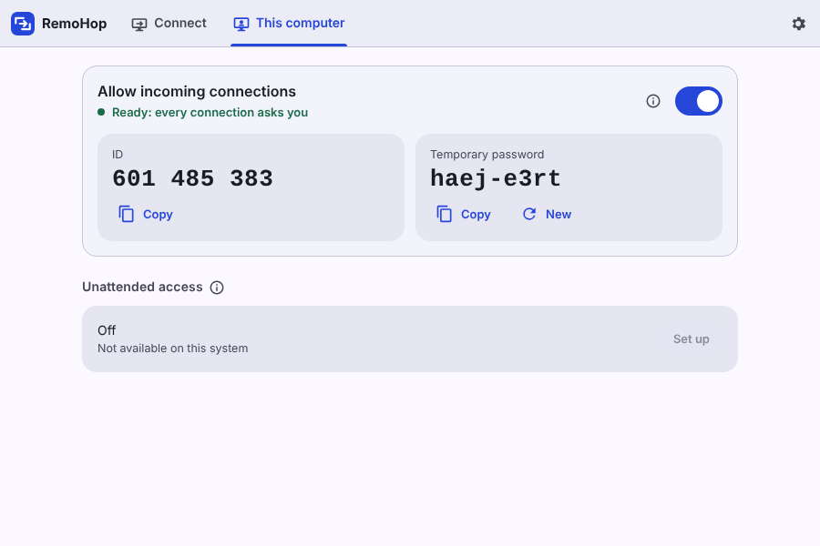
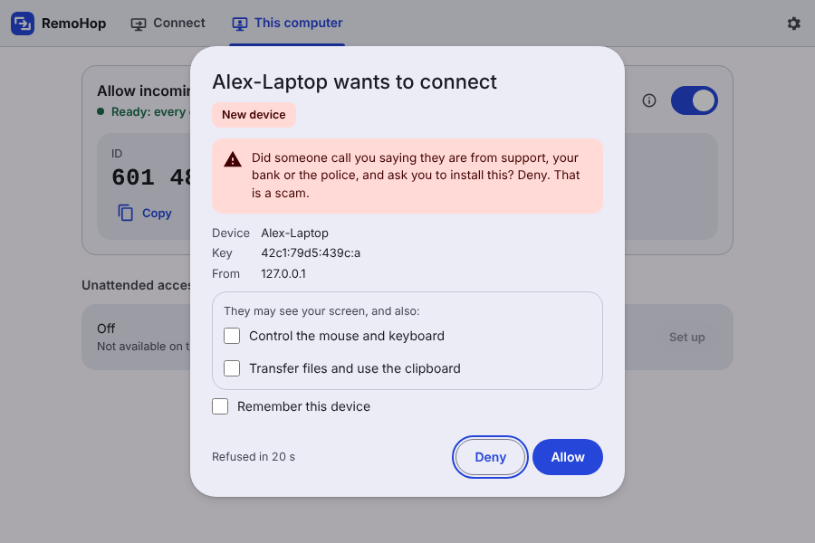

# Desktop app

[中文](../zh/desktop-app.md)

One window to connect to your other computers and to let someone connect to this one, on Windows, macOS and Linux. It is `RemoHop.exe`, `RemoHop.app` and `remohop-app` in the downloads ([Install](install.md#desktop-app)), and `remohop app` from a terminal.

| Home | Someone asks to connect |
|---|---|
|  |  |

| Connect | A computer open in the window |
|---|---|
|  |  |

The sidebar on the left has **Home**, **Connect** and **Sessions**, then every computer open in the window, then **Settings** and this computer's status. In a narrow window, or with the button beside the logo, it folds into a column of icons.

## First start

The app asks for the language (or follows the system) and the **rendezvous server**, the service that introduces computers to each other by ID: the official one (`signal.remohop.com`), your own ([Self-hosting](self-hosting.md)), or none for now. Without a server you connect by address (`host:port`), and this computer is reachable by address on its own network. Settings changes the choice later; it is the same setting as `remohop config set signal`.

A box on that page lets others connect at once. Otherwise incoming connections stay off until you switch them on.

## Connect

Type a 9-digit ID, a name you gave a computer, or `host:port`, or pick one of **Saved computers** (the ones you connected to or paired with, and your account's devices), each with whether it is online. Its menu (⋮) renames it, forgets it, saves its Wake-on-LAN MAC address and wakes it.

Each computer opens **in the window**, listed in the sidebar under *Open computers*, with the familiar Desktop, Terminal, Files, Clipboard and Info tabs ([remote desktop](remote-desktop.md), [browser client](web-gateway.md)). It asks for the password if nothing is remembered for it. With **Remember this computer** ticked, the app pairs with it, or, where the computer does not pair (quick support, another desktop app), saves its password on this device and logs in with it next time, until the password changes. The eye button in the field shows what you typed; in **Saved computers**, ⋮ shows or deletes a saved password. ⧉ moves the computer into a window of its own; × disconnects and closes it. **Home** also has a *Quick connect* field and the computers seen online most recently. A connection that drops (sleep, a new network) comes back by itself.

## Home: this computer

- **Allow incoming connections.** Off at first. On, Home shows this computer's **ID** and a **temporary password** (new on every start; "New" replaces it at once) with Copy buttons.
- **Screen sharing needs ffmpeg** on this computer. Without it, Home says so while incoming connections are on (files and commands still work), and on Windows and macOS offers **Install screen sharing component**: one click downloads a build pinned in RemoHop, checks its SHA-256 and shows the progress. See [Screen sharing and ffmpeg](remote-desktop.md#screen-sharing-and-ffmpeg).
- **Every connection asks.** A dialog comes to the front over any page: who asks (the name it gave itself, its key, its address), whether it is a **new device**, and for new devices a warning: *someone who calls saying they are from support, your bank or the police and asks you to install remote software is a scammer.* An allowed device **only sees the screen** unless you tick *Control the mouse and keyboard* or *Transfer files and use the clipboard*. A request nobody answers is refused after a minute. *Remember this device* lets it in next time with the same access, without asking, while incoming connections are on; remembered devices are listed with a Forget button.
- **Sessions** shows the requests waiting for an answer (with the time each has left), and **Connected now** lists each device with switches for Control and Files, which apply at once (a withdrawn permission ends what was open with it), and Disconnect. A device that only watches can ask for more from its side; that is a new question here. Sessions shows a red dot in the sidebar, and a small **banner stays on top of all windows** in the bottom-right corner of the screen while anyone is connected, with a Disconnect button.
- **Unattended access** makes this computer reachable without anyone at it, from start-up, with a strong password you choose (at least 12 characters, three kinds). It installs RemoHop as a service ([`remohop service install`](quick-start.md)): on Windows the RemoHop service, which can also show the sign-in screen and UAC prompts; on macOS and Linux a service of your user account. Its switch on **Home** is green while it is on and red while it is off. Its **Unattended ID** (on Windows the service has its own ID, not the app's) and **Unattended password** are under **Settings > Unattended ID and password**, the password hidden until **Show** (and hidden again after a minute); **Connections** lists who is connected through it (with Disconnect) and **Change password** replaces the password. The app itself never runs as administrator: on Windows, where the service's state belongs to the administrators, each of these steps (turning it on or off, showing the password, looking at its connections, disconnecting, a new password) asks Windows for an administrator at that moment.

## Settings

The rendezvous server, the language (Chinese, English or the system's), light or dark (or the system's), and **Start RemoHop when I sign in** (it starts in the tray, without its window).

## Updates

Once a day, and shortly after it starts, the app reads the newest version number from `https://remohop.com/version.json` (the request carries no identifier). When there is a newer release, a bar above the page says so, with **Download** (the download page), **What's new** (the release notes) and × to skip that version. Installed with Homebrew, Scoop, winget or Snap, the bar shows the upgrade command instead (`brew upgrade --cask remohop-quick`, `scoop update remohop`, `winget upgrade RemoHop.RemoHop`, `sudo snap refresh remohop`); from a .deb or .rpm, the system's package manager upgrades it. A copy downloaded from the website, in a folder you can write to, also gets **Upgrade now**: the app downloads the new version from GitHub, accepts it only if the release's signed checksums (an Ed25519 key built into RemoHop) match it, and on macOS only if it is signed by the RemoHop developer, then replaces itself and restarts. It does not upgrade while someone is connected to this computer, and it never downloads or installs anything without that click.

**Settings > Updates** switches the daily check off and has **Check now**. Administrators can switch it off for everyone with the environment variable `REMOHOP_NO_UPDATE_CHECK=1`. With unattended access on, turn it off and on again after upgrading, so that the service runs the new copy.

## Window, tray and background

Closing the window keeps RemoHop running in the tray (the menu bar on macOS), so incoming connections stay possible; Quit in the tray menu ends it and every connection. Starting RemoHop again brings the window back. Where the system has no tray (a Linux desktop without AppIndicator support), closing the window quits.

The window uses the system's web engine: WebView2 on Windows (part of Windows 10 and 11), WKWebView on macOS, WebKitGTK on Linux (the remote desktop there needs GStreamer's H.264 decoder, `gstreamer1.0-libav` on Debian and Ubuntu). Without one the app opens in a browser window instead, as does `remohop app` from the command-line binary.

On Linux `remohop-app` is linked against the GNU C library (it loads GTK for its window); on musl systems such as Alpine, run `remohop app` from the static `remohop` binary, which opens the app in a browser.

## Quick support

To help someone just once without anything staying behind, they download **Quick Support** instead (`RemoHop-QuickSupport.exe`, `RemoHop Quick Support.app`, `remohop-quick`): the same program, which starts in quick-support mode by its name, shares the screen at once and quits when its window closes. See [Quick support](quick-support.md). On macOS the system treats RemoHop and RemoHop Quick Support as two apps, so Screen Recording and Accessibility are granted to each separately (System Settings > Privacy & Security).

## Security

The window is a page served by the app on `127.0.0.1` with a random token in its address, the same protections as [quick support](quick-support.md), and nothing in it is reachable from another machine. The computers you connect to run in frames that only the app's own page may show. The design notes are in [desktop-app.md](../desktop-app.md).
