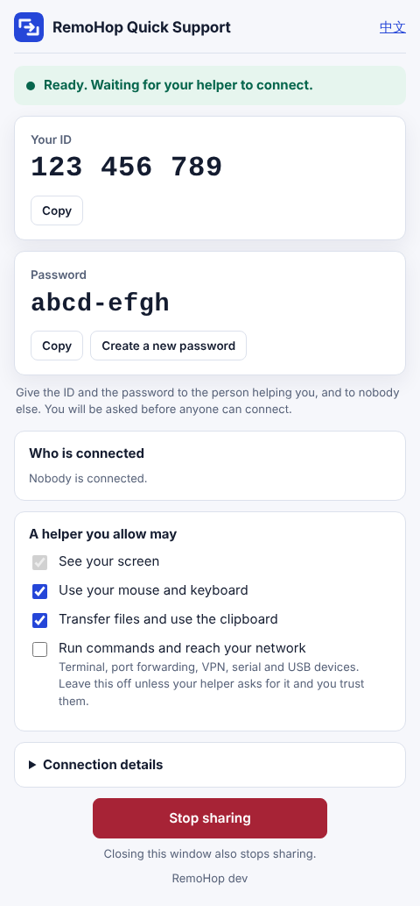
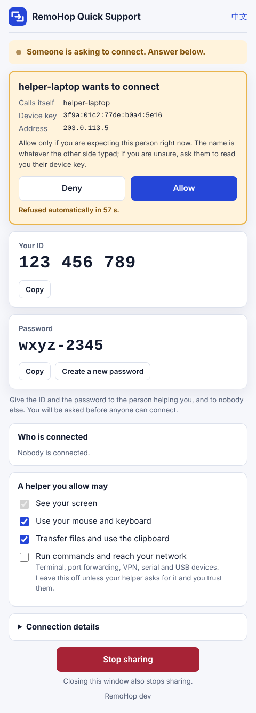

# Quick support

[中文](../zh/quick-support.md)

For helping someone who will never open a terminal: they double-click one file, read you an ID and a password, and press Allow when you connect.

| Ready | Someone asks to connect |
|---|---|
|  |  |

| System | What they open | Built by `make quick` as |
|---|---|---|
| Windows 10/11 | `RemoHop.exe` | `dist/quick/windows-amd64/RemoHop.exe` (and `windows-arm64`) |
| macOS 12+ | `RemoHop.app` | `dist/quick/macos/RemoHop.app` (universal) |
| Linux, or any terminal | `remohop quick` | `dist/quick/linux-*/remohop-quick` |

Every release has them as downloads (`RemoHop-windows-amd64.zip` and `-arm64.zip`, `RemoHop-macos.dmg`, `remohop-quick_linux_*.tar.gz`; see [Install](install.md#quick-support)). `RemoHop.exe` and `RemoHop.app` are the same program as `remohop`; started without arguments they run `remohop quick`.

What the person at the computer gets:

- **The ID and a temporary password, large,** with Copy buttons and "Create a new password". The password is new on every start; the ID stays the same for the computer.
- **A question for every connection.** The right password is not enough: each login waits until they press Allow, and is refused after 60 seconds without an answer. The request shows the name the other side gave itself, its device key (the fingerprint of its identity key) and its address. On Windows and macOS the same question also appears as a system dialog on top of everything else, so it is not missed when the window is buried; either place answers.
- **Who is connected,** each with a Disconnect button, and **Stop sharing**, which ends every session and quits. Closing the window stops sharing too.
- **Three switches** for what an allowed helper may do besides seeing the screen: use the mouse and keyboard (on), transfer files and use the clipboard (on), run commands and reach the network: terminal, port forwarding, VPN, serial, USB (off). They apply at once, also to a helper who is already connected, and the helper cannot open again what is switched off:
  - *Mouse and keyboard* off: the helper keeps seeing the screen. Any key or button the helper is holding is let go, nothing the helper types or clicks reaches the computer any more, and the helper's viewer switches to view-only, told so by this computer. Ticked again, the helper can take control in the same session.
  - *Files and clipboard* off: file transfers in progress stop (a file that was still arriving is not saved), and file browsing and clipboard sharing end.
  - *Commands and network* off: running commands are stopped, an open terminal is closed, forwarded connections and the VPN are cut, serial ports and USB devices are released. Background jobs the helper started (`spawn`) keep running; Stop sharing does not end them either.

  The details for each kind of access are in [Host access control](host-access-control.md#what-a-switch-does-to-sessions-already-connected).
- **The state of the connection in plain words:** registered with the server or not, still trying, and whether helpers come directly or through the relay.

The window follows the system language (Chinese or English) and can be switched in its corner; the choice is remembered for the next start and also applies to the system's connection dialogs. `--lang zh|en` overrides both.

You, the helper, connect as usual: `remohop <ID> desktop`, the browser client (`remohop web`) or the mobile app, with the password they read to you.

**The rendezvous server.** A build with a built-in server (`-X .../internal/dial.DefaultSignal=HOST:PORT`, see [Self-hosting the rendezvous server](self-hosting.md)) needs no setup. Without one, the window asks for the server address on first start and stores it (the same setting as `remohop config set signal`). To pass the build setting to `make quick`: `EXTRA_LDFLAGS="-X github.com/readori/RemoHop/internal/dial.DefaultSignal=HOST:21116" make quick`.

**What a quick-support host allows, whatever `remohop config` says:** approval for every login, pairings and authorised keys included; only the temporary password of this run (a fixed `host-password` is ignored); no new pairings; and only the features ticked in the window. Features switched off with `remohop config feature` stay off. It uses the same identity as `remohop host`, so the computer has one ID; if a host is already running there (a service, or `remohop host` in a terminal), the window says so instead of starting a second one. Starting RemoHop again while quick support runs brings its window back.

**How the window works, and what protects it.** There is no native toolkit in RemoHop (it stays pure Go, without cgo), so the window is a page served by the process itself on `127.0.0.1`, opened in an app window of Microsoft Edge on Windows and in the default browser elsewhere (`--browser` forces the default browser, `--no-open` only prints the address). It cannot be reached from another machine, its address contains a 128-bit random token, requests with a foreign `Host` or `Origin` are refused (DNS rebinding, cross-site requests), and every action is a JSON request carrying a second secret. A client waiting for approval has no session and therefore no way to move the mouse on that computer: nobody can approve themselves. A helper who *has* been allowed and can use the mouse can click anything on that screen, this window included; that is what allowing remote control means, and why the mouse-and-keyboard switch exists.

Limits to know about:

- **Windows:** `RemoHop.exe` is not code-signed yet, so SmartScreen warns on first start ("More info", then "Run anyway"). It runs without administrator rights, so the helper cannot operate UAC prompts or windows of programs running as administrator. Windows Firewall may ask about network access on first start; connections work with either answer on most networks, because the host connects outwards.
- **macOS:** the first connection needs the Screen Recording permission, and mouse and keyboard need Accessibility (System Settings > Privacy & Security; both are listed as "RemoHop", and Screen Recording takes effect after RemoHop is started again). The `RemoHop-macos.dmg` download is signed with a Developer ID, notarized and stapled; a `RemoHop.app` you build yourself is unsigned; see [packaging/quick/README.md](../../packaging/quick/README.md) for signing and notarization.
- The page and its server are tested in a real browser on Linux. The Windows and macOS pieces around them (the Edge app window, the system dialogs, the `.app` bundle) compile and are checked structurally but have not been run on those systems yet.
