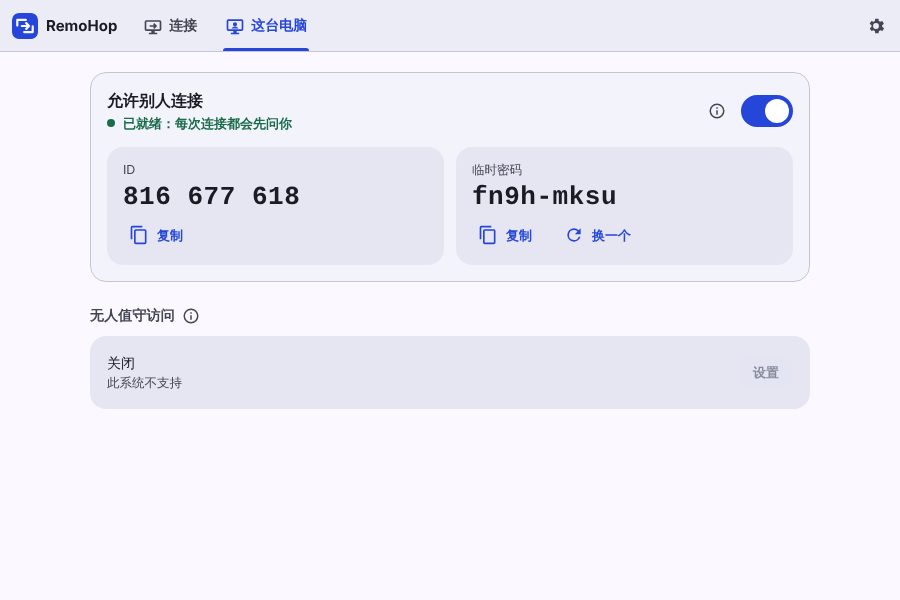
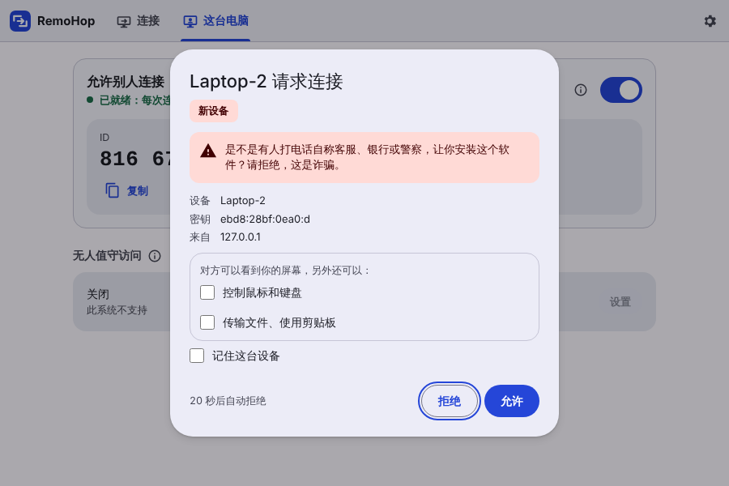
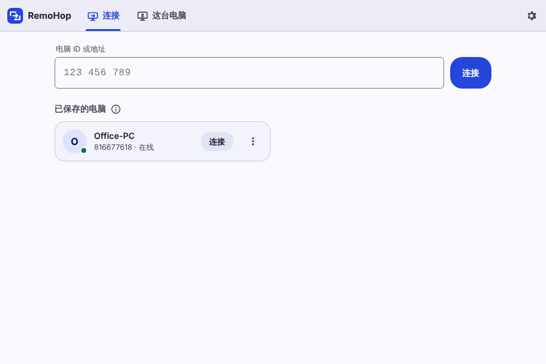
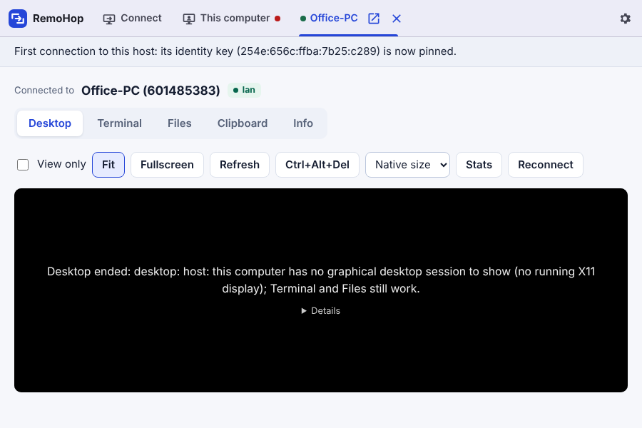

# 桌面应用

[English](../en/desktop-app.md)

一个窗口，既能连接你的其他电脑，也能让别人连接这台电脑，支持 Windows、macOS 和 Linux。双击 RemoHop.exe、RemoHop.app 或 `remohop-quick` 打开的就是它（在终端里是 `remohop app`）。

| 这台电脑 | 有人请求连接 |
|---|---|
|  |  |

| 连接 | 已连接的电脑 |
|---|---|
|  |  |

## 第一次启动

应用会询问语言（或跟随系统）和**汇合服务器**，也就是按 ID 为电脑牵线的服务：官方服务器（`signal.remohop.com`）、你自己的服务器（见[自建](self-hosting.md)），或暂时不用。不用服务器时按地址（`主机:端口`）连接，这台电脑也可以在本地网络中按地址访问。之后可在“设置”中更改；它与 `remohop config set signal` 是同一个设置。

这一页上有个选项可以立即允许别人连接；否则在你打开之前，别人都连不上。

## 连接

输入 9 位 ID、你给电脑起的名称或 `主机:端口`，或者从**已保存的电脑**中选择（连接过或配对过的电脑，以及账号中的设备），每台都显示是否在线。它的菜单（⋮）可以重命名、移除、保存网络唤醒的 MAC 地址并唤醒它。

每台电脑都在“连接”和“这台电脑”旁边的**单独标签页**中打开，里面是熟悉的桌面、终端、文件、剪贴板和信息（见[远程桌面](remote-desktop.md)、[浏览器客户端](web-gateway.md)）。没有配对时会要求输入密码（勾选“配对”可以保存）。⧉ 把这台电脑移到单独的窗口；× 断开并关闭标签页。连接断开（睡眠、换了网络）后会自动恢复。

## 这台电脑

- **允许别人连接。**默认关闭。打开后，标签页显示这台电脑的 **ID** 和**临时密码**（每次启动都会换新，“换一个”立即更换），都带复制按钮。
- **每次连接都会询问。**无论在哪个标签页，都会弹出对话框：谁在请求（对方自称的名称、密钥和地址）、是否是**新设备**；对新设备还会提醒：*有人打电话自称客服、银行或警察，让你安装远程软件，那是诈骗。*被允许的设备**只能看屏幕**，除非你勾选“控制鼠标和键盘”或“传输文件、使用剪贴板”。一分钟内没人回答的请求会被拒绝。“记住这台设备”让它下次以相同权限直接连入（在允许连接打开时）；已记住的设备会列出来，可以移除。
- **当前连接**列出每台设备，带“控制”和“文件”开关（立即生效，收回的权限会结束正在使用它的操作）和“断开”。只能查看的设备可以从它那边请求更多权限，这里会再问你一次。有人连接时标签页上有红点，一个小**横幅始终显示在所有窗口之上**，带“断开”按钮。
- **无人值守访问**让这台电脑在没人时也能连上，开机即可用，使用你设定的强密码（至少 12 个字符，包含三类字符）。它把 RemoHop 安装为服务（[`remohop service install`](quick-start.md)）：在 Windows 上是 RemoHop 服务，还能显示登录界面和 UAC 提示（Windows 会请求一次管理员授权）；在 macOS 和 Linux 上是你用户账号的服务。在同一处可以关闭。

## 设置

汇合服务器、语言（中文、英文或跟随系统）、浅色或深色（或跟随系统），以及**登录时启动 RemoHop**（启动后只在托盘中，不显示窗口）。

## 窗口、托盘与后台

关闭窗口后 RemoHop 会留在托盘（macOS 上是菜单栏）中继续运行，别人仍可连接；托盘菜单中的“退出”会结束它和所有连接。再次启动 RemoHop 会显示原来的窗口。系统没有托盘时（不支持 AppIndicator 的 Linux 桌面），关闭窗口即退出。

窗口使用系统自带的网页引擎：Windows 上是 WebView2（Windows 10 和 11 自带），macOS 上是 WKWebView，Linux 上是 WebKitGTK（远程桌面需要 GStreamer 的 H.264 解码器，Debian 和 Ubuntu 上是 `gstreamer1.0-libav`）。没有时应用会改在浏览器窗口中打开，命令行程序的 `remohop app` 也是如此。

## 快速协助

只想帮别人一次、不留下任何东西时，对方可以改用快速协助：`RemoHop.exe --quick`（或 `remohop quick`），它立即共享屏幕，关闭窗口即退出。见[快速协助](quick-support.md)。

## 安全

窗口是应用在 `127.0.0.1` 上提供的页面，地址中带随机令牌，保护措施与[快速协助](quick-support.md)相同，其他机器无法访问。你连接的电脑显示在只有应用自己的页面才能嵌入的框架中。设计说明见 [desktop-app.md](../desktop-app.md)。
