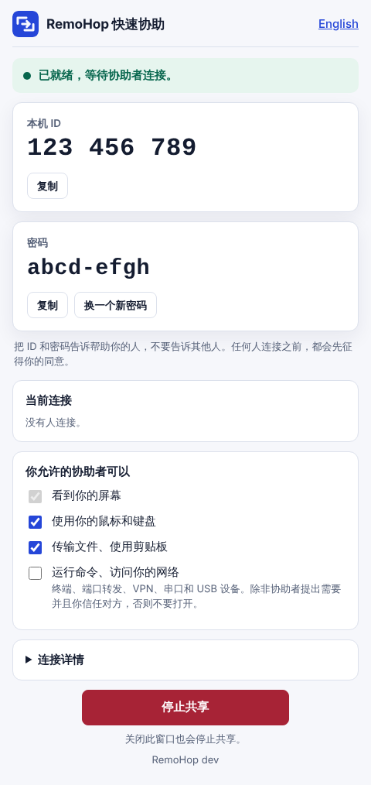
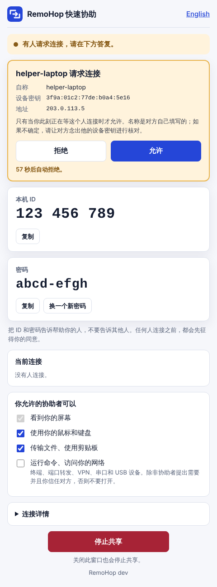

# 快速协助

[English](../en/quick-support.md)

用来帮助一个永远不会打开终端的人：对方双击一个文件，把 ID 和密码念给你，在你连接时点“允许”。不会留下任何东西：关闭窗口即结束。（[桌面应用](desktop-app.md)的“这台电脑”标签页也能做到，并且会一直保留。）

| 就绪 | 有人请求连接 |
|---|---|
|  |  |

| 系统 | 对方打开的文件 | `make quick` 的产物 |
|---|---|---|
| Windows 10/11 | `RemoHop-QuickSupport.exe` | `dist/quick/windows-amd64/RemoHop-QuickSupport.exe`（以及 `windows-arm64`） |
| macOS 12 及以上 | `RemoHop Quick Support.app` | `dist/quick/macos/RemoHop Quick Support.app`（通用二进制） |
| Linux，或任何终端 | `remohop-quick`，或 `remohop quick` | `dist/quick/linux-*/remohop-quick` |

每个发布版本都提供下载（`RemoHop-QuickSupport-windows-amd64.zip` 和 `-arm64.zip`、`RemoHop-QuickSupport-macos.zip`、`remohop-quick_linux_*.tar.gz`，见[安装](install.md#快速协助)）。`RemoHop.exe` 和 `RemoHop.app` 与 `remohop` 是同一个程序；双击时打开什么由文件名决定：名字里有“quick”（`RemoHop-QuickSupport.exe`、`RemoHop Quick Support.app`、`remohop-quick`）就运行 `remohop quick`，否则打开[桌面应用](desktop-app.md)。任何名字下 `RemoHop.exe --quick` 都等同于前者。

坐在电脑前的人会看到：

- **大字显示的 ID 和临时密码**，带“复制”按钮和“换一个新密码”。密码每次启动都会更换；这台电脑的 ID 保持不变。
- **每个连接都要询问。** 只有正确的密码还不够：每次登录都要等对方点“允许”，60 秒内没有答复就会被拒绝。请求里会显示对方自称的名称、设备密钥（对方身份密钥的指纹）和地址。在 Windows 和 macOS 上，同一个问题还会以系统对话框的形式弹到最前面，窗口被挡住时也不会错过；在哪一处回答都可以。
- **当前连接的人**，每个都有“断开”按钮；以及**停止共享**，它会结束所有会话并退出。关闭窗口同样会停止共享。
- **三个开关**，决定被允许的协助者除了看屏幕之外还能做什么：使用鼠标和键盘（开）、传输文件和使用剪贴板（开）、运行命令和访问网络，即终端、端口转发、VPN、串口、USB（关）。开关立即生效，对已经连接的协助者也一样，关掉的部分协助者也无法再次打开：
  - 关闭*鼠标和键盘*：协助者仍能看到屏幕。协助者按住的按键和鼠标按钮会被松开，此后协助者的键盘和鼠标操作都不再作用于这台电脑，协助者的查看器在收到这台电脑的通知后切换为仅查看。重新勾选后，协助者可以在同一个会话里恢复控制。
  - 关闭*文件和剪贴板*：进行中的文件传输停止（尚未传完的文件不会保存），文件浏览和剪贴板共享结束。
  - 关闭*命令和网络*：正在运行的命令被终止，打开的终端被关闭，转发的连接和 VPN 被切断，串口和 USB 设备被释放。协助者启动的后台任务（`spawn`）会继续运行，停止共享也不会结束它们。

  每类访问的细节见[被控端访问控制](host-access-control.md#开关对已连接会话的作用)。
- **用平常话说明的连接状态：** 是否已在服务器注册、是否仍在尝试，以及协助者是直接连接还是经由中继。服务器 12 秒仍无响应时，窗口会显示“仍在尝试连接 X。请和协助者核对这个地址。”，并提供 **更换服务器** 按钮重新选择服务器，地址填错了也不必从头再来。

窗口语言跟随系统（中文或英文），也可以在窗口右上角切换；切换后的选择下次启动时仍然有效，系统弹出的连接确认对话框也使用同一语言。`--lang zh|en` 优先于以上两者。

你作为协助者照常连接：`remohop <ID> desktop`、浏览器客户端（`remohop web`）或手机应用，使用对方念给你的密码。

**汇合服务器。** 内置了服务器的构建（`-X .../internal/dial.DefaultSignal=HOST:PORT`，见[自建汇合服务器](self-hosting.md)）无需任何设置。否则窗口会像桌面应用的首次设置向导一样询问一次：官方服务器 `signal.remohop.com`（默认选中）、协助者给的地址，或不用服务器（协助者在同一网络中按地址连接）。所做的选择保存在共享设置中（`remohop config set signal` 或 `signal-none`），所以已在桌面应用中选过的电脑不会再被询问。要把这个构建参数传给 `make quick`：`EXTRA_LDFLAGS="-X github.com/readori/RemoHop/internal/dial.DefaultSignal=HOST:21116" make quick`。

**无论 `remohop config` 怎么设置，快速协助的被控端都只允许：** 每次登录都要批准，包括已配对的客户端和已授权的密钥；只接受本次运行的临时密码（忽略固定的 `host-password`）；不签发新的配对；只开放窗口里勾选的功能。用 `remohop config feature` 关闭的功能仍然关闭。它和 `remohop host` 使用同一个身份，所以一台电脑只有一个 ID；如果那里已经有被控端在运行（系统服务，或终端里的 `remohop host`），窗口会说明这一点，而不是再启动一份。快速协助运行期间再次启动 RemoHop，会把它的窗口重新调出来。

**窗口的工作方式和保护措施。** RemoHop 不使用原生界面库（保持纯 Go、无 cgo），所以窗口是进程自己在 `127.0.0.1` 上提供的一个页面：在 Windows 上用 Microsoft Edge 的应用窗口打开，在其他系统上用默认浏览器打开（`--browser` 强制使用默认浏览器，`--no-open` 只打印地址）。别的机器访问不到它；地址里带有 128 位随机令牌；`Host` 或 `Origin` 不对的请求会被拒绝（防 DNS 重绑定和跨站请求）；每个操作都是携带第二个密钥的 JSON 请求。等待批准的客户端还没有会话，因此无法移动那台电脑的鼠标：没有人能批准自己。而已经被允许、并且可以使用鼠标的协助者，可以点击屏幕上的任何东西，包括这个窗口；这正是“允许远程控制”的含义，也是“鼠标和键盘”开关存在的原因。

需要了解的限制：

- **屏幕共享需要被协助的电脑上装有 ffmpeg**（带 H.264 或 AV1 编码器）。RemoHop 的安装包不附带它（见 [LICENSING.md](../../LICENSING.md)）。没有 ffmpeg 时，窗口会显示“屏幕共享需要 ffmpeg，但这台电脑上没有安装。协助者仍然可以使用文件和命令。”，协助者的 `remohop <ID> desktop` 也会说明被控端没有 ffmpeg；`remohop <ID> screenshot` 仍然可以截取屏幕画面。在 Windows 和 macOS 上，这条提示下有一个按钮 **安装屏幕共享组件**：它下载 RemoHop 中固定的一个 ffmpeg 版本，解压前先用写在 RemoHop 里的 SHA-256 校验，并显示进度；之后开始的会话就能看到屏幕。不按这个按钮就不会下载任何东西。来源、存放位置以及如何关闭下载，见 [屏幕共享与 ffmpeg](remote-desktop.md#屏幕共享与-ffmpeg)。在 Linux 上请用包管理器安装（`apt install ffmpeg`）。在那台电脑上运行 `remohop doctor` 可以查看用的是哪个 ffmpeg。
- **Windows：** `RemoHop.exe` 尚未做代码签名，首次启动时 SmartScreen 会给出警告（点“更多信息”，再点“仍要运行”）。它不以管理员权限运行，所以协助者无法操作 UAC 提示框，也无法操作以管理员身份运行的程序窗口。首次启动时 Windows 防火墙可能询问是否允许联网；在大多数网络中无论怎么回答都能连接，因为被控端是向外发起连接的。
- **macOS：** 第一次连接需要“屏幕录制”权限，鼠标和键盘需要“辅助功能”权限（系统设置 > 隐私与安全性；单独下载的快速协助显示为“RemoHop Quick Support”，完整应用显示为“RemoHop”。macOS 把它们当作两个应用，权限要分别授予；“屏幕录制”要在重新启动应用后才生效）。下载的 `RemoHop-macos.dmg` 已用 Developer ID 签名、经过公证并附带公证票据；自己构建的 `RemoHop.app` 没有签名；签名和公证见 [packaging/quick/README.md](../../packaging/quick/README.md)。
- 页面及其服务器在 Linux 上用真实浏览器测试过；启动器窗口在 CI 中于 Windows、macOS 和 Linux 上实际启动并截图。
